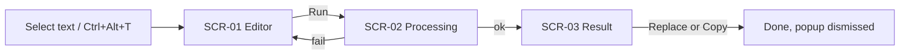

# Fast English — UI/UX Design Spec (ui-restyle)

> Gate 1 record: mode=codebase | decision=restyle | scope=all (SCR-01…SCR-06) |
> non-goals=no Rust/behavior changes, no new features, no window-size changes
> (popup 520w/296h-initial, settings 380×560) | date=2026-08-27
> Gate 2: inventory approved 2026-08-27, frozen at `12525ca` — see [screens.md](./screens.md).
> Visual basis: **code-only, unverified visuals** (app not run during design).

## 1. Product Context

Windows 11 tray utility (Rust + tao/wry, WebView2). Selection-triggered / hotkey
(Ctrl+Alt+T) popup that runs 4 AI writing tools (enhance, fix-grammar,
convert-prompt, translate) against a user-configured OpenAI-compatible endpoint.
Single user, keyboard-heavy, appears over other apps → must read instantly and
feel native to Win11 (Fluent). Existing direction "Fluent Midnight" (dark-first)
is kept and refined, not replaced.

## 2. Information Architecture

Unchanged (restyle). One popup window with 5 exclusive views + one separate
settings window; entry via tray menu, global hotkey, or selection auto-popup.
Route map + nav edges: [screens.md](./screens.md) flow graph.
Modality: settings is the only secondary window; everything else is in-popup
view switching (`showView()`, `popup.js:56`).

## 3. User Flows

### Flow: Transform selected text (primary)
Goal: selection → improved text back in the source app.

Edge cases: empty input (Run disabled); failure from editor ctx → SCR-01 banner
(not SCR-05); truncated answer → notice beside kept partial text (never
discarded); diff unavailable >800 tokens/side → raw + note.

### Flow: Reuse past result
SCR-01/tray → SCR-04 History → entry → SCR-03 → Copy/Replace. Edge: empty
history state; Clear requires confirm.

### Flow: First-run configuration
Tray → SCR-06 Settings → fill endpoint/model/key → Test Connection
(idle→testing→success/failure) → Save. Edge: dirty-close discards (Cancel/Esc
revert); save feedback 2.5s.

## 4. Screen Specs

See [screens.md](./screens.md) — anchor-verified inventory frozen at `12525ca`.

Mockups (static HTML, share [tokens.css](./tokens.css); Gate 3 direction approved
2026-08-27 on SCR-01 + SCR-03 pilots, then fanned out):
[SCR-01](./mockups/scr-01-editor.html) · [SCR-02](./mockups/scr-02-processing.html) ·
[SCR-03 diff](./mockups/scr-03-result-diff.html) · [SCR-04](./mockups/scr-04-history.html) ·
[SCR-05](./mockups/scr-05-error.html) · [SCR-06](./mockups/scr-06-settings.html).
Audited against Web Interface Guidelines (vercel-labs) 2026-08-27; fixes applied:
explicit transition properties (no `transition: all`), `aria-hidden` decorative
SVGs, `color-scheme`/`theme-color` meta, input `name`/`autocomplete`/`spellcheck`,
flex truncation `min-width:0`, tab roles on tool pills. Mockup HTML is reference
for implementation — never copy-paste into the app's component system.

## 5. Design System

Machine source: [tokens.css](./tokens.css) (proposed evolution of live
`assets/popup/tokens.css`). Summary of disposition:

| Group | Disposition |
|---|---|
| Surfaces, borders, primary, text, status, tool accents | **kept unchanged** (live sheet already WCAG-AA-corrected, dark #0F1219 base) |
| Spacing / radius / shadow / z / transitions | **kept unchanged** |
| Font stack Segoe UI Variable + Cascadia mono | **kept** (Fluent-native; overrides stale Plus-Jakarta note in docs/design-guidelines.md) |
| `--font-size-xs` | **changed** 9px → 10px (legibility floor) |
| `--color-info` + surface | **new** — Settings "Testing…" badge state (4th status) |
| `--color-diff-ins/del-*` | **new** — dedicated diff tokens, decoupled from success/error |
| `--color-kbd-*` | **new** — keyboard hint chips |
| `--color-skeleton-*` | **new** — pre-stream shimmer placeholder |
| `--focus-ring` (+inset) | **new** — unified 2px keyboard focus ring |
| reduced-motion media zeroing transitions | **new** |

Component styles (restyle targets, all within existing DOM):
- **Buttons:** primary (filled `--color-primary-default`, hover `-hover`, active
  `-active`, disabled 0.45 opacity + no pointer), secondary (ghost on
  `--color-surface-hover`), destructive (error fg, error-surface hover). All get
  `--focus-ring` on :focus-visible, min height 32px, radius `--radius-md`.
- **Tool pills (SCR-01):** per-tool accent bg/fg tokens; selected = accent bg +
  1px accent border + medium weight; unselected = transparent + secondary text.
- **Inputs/textarea:** `--color-surface-input`, 1px `--color-border-default`,
  focus → `--color-border-focus` + `--focus-ring-inset`; placeholder
  `--color-text-muted`.
- **Cards/sections:** `--color-surface-card`, radius `--radius-lg`, border
  `--color-border-subtle`; elevated (menus, toasts) add `--shadow-md`.
- **Diff (SCR-03):** `.diff-ins`/`.diff-del` move to the new diff tokens;
  del keeps line-through, ins no underline (Grammarly pattern).
- **Badges (SCR-06 test status):** idle = muted outline; testing = info surface
  + spinner; success/failure = status surfaces + icon (color never sole carrier).
- **Kbd chips:** `--color-kbd-*`, `--font-size-xs`, radius `--radius-sm` — used
  for Ctrl+Enter / Esc hints in footers (Superhuman/Fey pattern).
- **Skeleton (SCR-02):** 2–3 shimmer bars in stream region before first chunk
  replaces the bare spinner wait (Qatalog/WRITER pattern).

## 6. Interaction & Motion

- Timing: micro-interactions `--transition-base` 200ms; view switches crossfade
  ≤200ms; exits faster than enters; everything zeroed under
  `prefers-reduced-motion` (new tokens block).
- Focus: `:focus-visible` ring on every interactive element; tab order already
  matches visual order (views are `tabindex="-1"` sections).
- Feedback: press states darken via `--color-primary-active` / surface-active;
  Copy keeps 1.5s toast (aria-live polite); Save keeps 2.5s feedback; buttons
  disable during async (Run while processing).
- Streaming (SCR-02): `aria-live="polite"` kept; skeleton → text swap without
  height jump (region height cap 45% is behavior, untouched).
- Truncation notice (SCR-03): restyle as warning-surface inline card with icon,
  visually distinct from error — it accompanies a kept answer.
- A11y baseline: WCAG AA 4.5:1 body text both themes (already met by live
  tokens); status meaning always icon+text; hover never sole affordance;
  min target ≥32px in this desktop-popup context.

## 7. References

Mobbin (primary; queried by archetype, 2026-08-27):
- SCR-01 Editor: [Hashnode rewrite popup](https://mobbin.com/screens/092a8062-a1d1-47e9-beee-49031a9832d5) — compact input + labeled action list, why: same "small window over content" shape as our popup; [Canva Magic Write](https://mobbin.com/screens/a7faf3e1-c2fc-4eec-b9ee-c2d975375b6c) — action chips row, why: grounds tool-pill styling.
- SCR-02 Processing: [WRITER rewrite card](https://mobbin.com/screens/65eaa501-c59e-47e8-8feb-82715829ec9e) — inline "rewriting" progress card, why: progress inside the card, not modal; [ClickUp Stop generating](https://mobbin.com/screens/3bff7165-d87a-4f59-b08e-530da331b68e) — cancel-as-pill during generation, why: matches our Cancel; [Qatalog preparing-answer bar](https://mobbin.com/screens/f53931fd-7ada-492d-877d-118a5de477a9) — status + "Cancel Esc" kbd hint, why: grounds kbd-chip pattern.
- SCR-03 Result: [Grammarly suggestion card](https://mobbin.com/screens/82d0d01f-8aa2-4fe4-a658-1498c92fb1ae) — del-strikethrough/ins-highlight diff + Accept/Dismiss, why: canonical word-diff styling; [Remote AI revised panel](https://mobbin.com/screens/f6ab68ea-04c0-41e2-905b-636d34db16ec) — revised-text panel with source context, why: grounds source-snippet + output split.
- SCR-04 History: [Grok history panel](https://mobbin.com/screens/5bf3fb45-8d30-4608-afda-d17d2ea7969e) — day-grouped plain rows, why: low-chrome list fits 520px; [Sana AI docs list](https://mobbin.com/screens/7e164f55-0807-4fb9-957e-324eb42cd9ea) — timestamp-right layout, why: entry metadata placement.
- SCR-06 Settings: [n8n credential modal](https://mobbin.com/screens/d692ee23-3644-494e-9f0b-b09d8e04d073) — key/base-URL form + "Connection tested successfully" banner + Retry, why: exact same form domain incl. test feedback; [Adaline provider modal](https://mobbin.com/screens/3bf39a0e-210e-474b-877b-8c03d93d3a98) — labeled fields with helper text under each, why: helper-text pattern for base-URL/model.
- Palette/kbd anchors: [Superhuman Command](https://mobbin.com/screens/85dc5994-9360-428d-9092-7425e070ed7f), [Fey](https://mobbin.com/screens/ff52ac90-4d18-4765-98da-df1e362a5ee1) — dark elevated panel + kbd chips, why: aesthetic anchor for Fluent Midnight refinement.

ak-ui-ux-pro-max (supplement): adopted — dark-mode-utility direction, contrast/
focus/reduced-motion checklist, 150–300ms timing. Rejected (Mobbin/incumbent
wins): Inter font swap, orange #F97316 CTA, landing-page section pattern.

## 8. Open Questions

1. Font: live app uses Segoe UI Variable; stale docs/design-guidelines.md says
   Plus Jakarta Sans; ux-pro-max suggested Inter. Spec keeps Segoe UI Variable —
   confirm, or pick a brand font (would need bundling; WebView2 has no CDN
   guarantee offline).
2. `--font-size-xs` 9px→10px touches any element using the token — acceptable
   within "no behavior change"? (Pure CSS, but 1px metrics shift.)
3. docs/design-guidelines.md is out of sync with live tokens.css (old palette,
   old font). Update it to point at this spec once approved?
4. Truncation notice copy "Run it again on a shorter selection" flagged earlier
   as possibly reading like an error — copy change is in-scope for mockups but
   needs your wording approval.
