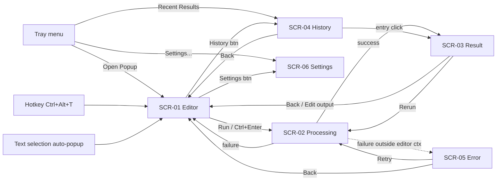

# Fast English — Screen Inventory

> mode=codebase | frozen-at=12525caca6127d8609cf4241ec130037c8fcd735 |
> verified=2026-08-27 (anchor spot-check 7/7 exact; adversarial route-diff: 0 mismatches, 0 orphans; reachability: all reachable) |
> scope=all | **code-only, unverified visuals** (Windows-only tray app; not run during scout)

Gate 1 answers: **restyle in place** (IA unchanged) | scope: **all screens** |
non-goals: **no Rust/behavior changes, no new features, no window-size changes** (popup 520px w / 296px initial h, settings 380×560).

## Flow graph

All screens also exit to Hidden via Close/Escape/Dismiss.

## Screens

### SCR-01 — Editor
- **Route:** popup `#view-editor`
- **Purpose:** Enter/see captured text, pick a writing tool, run it.
- **Data shown:** `sourceText`, char count, active tool, `languages[]` (translate mode from/to selects)
- **Actions:** tool pill → ToolSelected; type → UpdateSourceText; Run/Ctrl+Enter → SCR-02; History → SCR-04; Settings → SCR-06; swap/change languages (translate); Close/Esc → hidden
- **States:** empty (Run disabled), error banner (`#editor-error-banner`, shown when a run fails from editor context), translate controls hidden unless translate tool, textarea auto-grow capped at 60% popup height
- **Nav edges:** in: tray/hotkey/auto-popup, SCR-03 Back/Edit-output, SCR-04 Back, SCR-05 Back | out: SCR-02, SCR-04, SCR-06, hidden
- **Anchor:** `assets/popup/index.html:17`; controller `src/ui/popup_controller.rs:25-126`
- **Screenshot:** none (code-only)

### SCR-02 — Processing
- **Route:** popup `#view-processing`
- **Purpose:** Spinner + live streamed output while the AI request runs.
- **Data shown:** tool title ("Running X…"), streamed chunks (`#processing-stream-output`, aria-live)
- **Actions:** Cancel → CancelProcessing → SCR-01; Close/Esc → hidden
- **States:** stream region hidden until first chunk, then capped at 45% height and scrolls
- **Nav edges:** in: SCR-01 Run, SCR-03 Rerun, SCR-05 Retry | out: SCR-03 (success), SCR-01 error banner (failure from editor ctx), SCR-05 (failure otherwise), hidden
- **Anchor:** `assets/popup/index.html:75`; `src/ui/popup_controller.rs:198-205`
- **Screenshot:** none (code-only)

### SCR-03 — Result
- **Route:** popup `#view-result`
- **Purpose:** Show AI output; copy, replace, rerun, or continue editing it.
- **Data shown:** tool label, collapsible source snippet, output in one of 3 modes (raw / rich markdown / word diff), truncation notice (`#result-notice`), output char count
- **Actions:** toggle MD preview; toggle Diff (enhance/fix-grammar only; falls back raw + "Too much changed" note >800 tokens/side); Back → SCR-01; Rerun/Ctrl+Enter → SCR-02; Edit output → SCR-01 (output becomes input); Copy (1.5s toast); Replace (disabled if `canReplace=false`); Close/Esc → hidden
- **States:** raw/rich/diff modes, diff-too-large note, copy toast, notice banner, source snippet collapsed by default
- **Nav edges:** in: SCR-02 success, SCR-04 entry click | out: SCR-01, SCR-02, hidden
- **Anchor:** `assets/popup/index.html:94`; diff `assets/popup/diff.js:16`
- **Screenshot:** none (code-only)

### SCR-04 — History
- **Route:** popup `#view-history`
- **Purpose:** Browse recent results.
- **Data shown:** `entries[]` (tool, locale timestamp, output snippet, source snippet), entry count
- **Actions:** entry click → SCR-03; Clear (confirm) → ClearHistory; Back → SCR-01; Close/Esc → hidden
- **States:** empty state (`#history-empty`)
- **Nav edges:** in: SCR-01 History btn, tray "Recent Results" | out: SCR-03, SCR-01, hidden
- **Anchor:** `assets/popup/index.html:153`; tray entry `src/ui/tray.rs:77-78`
- **Screenshot:** none (code-only)

### SCR-05 — Error (full-screen)
- **Route:** popup `#view-error`
- **Purpose:** Failure surface when the error originates outside editor context (e.g. history action fails); editor-context failures use SCR-01's banner instead.
- **Data shown:** error message, error status dot
- **Actions:** Try again → Retry → SCR-02; Back → SCR-01; Dismiss/Close/Esc → hidden
- **States:** single state
- **Nav edges:** in: failed op outside editor ctx | out: SCR-02, SCR-01, hidden
- **Anchor:** `assets/popup/index.html:181`; routing `assets/popup/popup.js:104-112`
- **Screenshot:** none (code-only)

### SCR-06 — Settings (separate window, 380×560)
- **Route:** settings window `#settings-root`
- **Purpose:** Configure AI endpoint, theme, behavior; test connection.
- **Data shown:** `base_url`, `model`, `api_key` (masked, test-only), theme (auto/dark/light), auto-popup toggle, auto-start toggle, hotkey display (read-only Ctrl+Alt+T), version, test-status badge
- **Actions:** edit fields → dirty state enables Save; theme change applies live; Test Connection → badge idle/testing/success/failure; Save (2.5s feedback); Reset → inline Yes/No confirm; Cancel/Close/Esc → revert + close
- **States:** dirty indicator, save ok/fail feedback, test badge 4 states, reset confirm swap
- **Nav edges:** in: SCR-01 Settings btn, tray "Settings..." | out: closed (save or discard)
- **Anchor:** `assets/popup/settings.html:14`; window `src/ui/webview_popup.rs:178-187`
- **Screenshot:** none (code-only)

## System surfaces (context, not restyled)

Tray menu (Open Popup / Recent Results / Settings... / Quit) `src/ui/tray.rs:21-31`;
global hotkey `src/hotkey.rs:29`; view switch mechanism `showView()`
`assets/popup/popup.js:56` + `STATE_RENDERERS` `popup.js:78-113`.

## Fixed constraints (non-goals honor these)

Popup width 520 (`src/ui/popup_position.rs:21`), initial h 296, min h 120, max 70% screen;
settings 380×560 (`src/ui/webview_popup.rs:183`); stream region 45%; diff cap 800 tokens/side.
